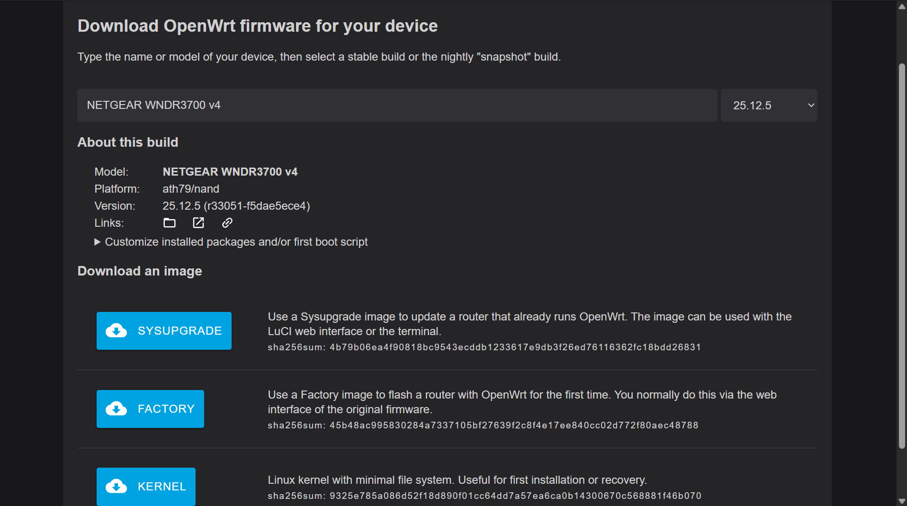
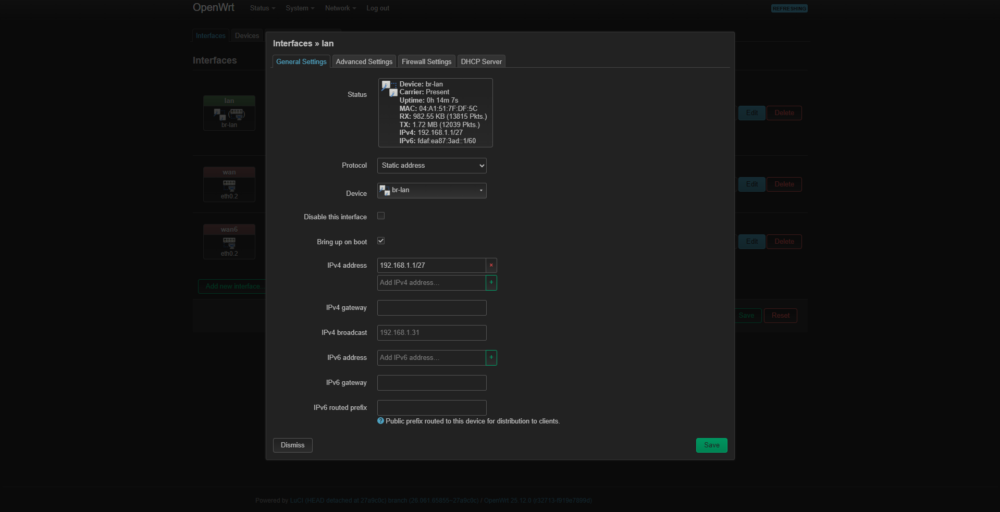
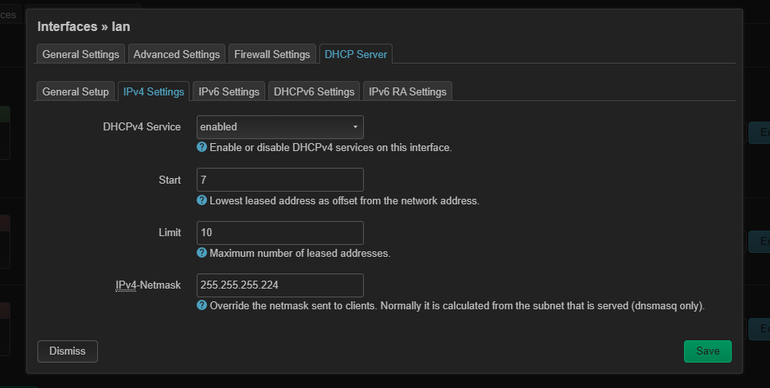
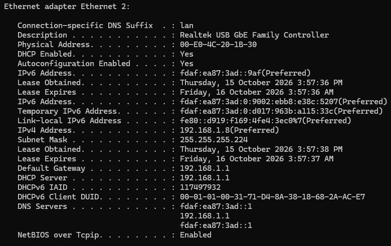
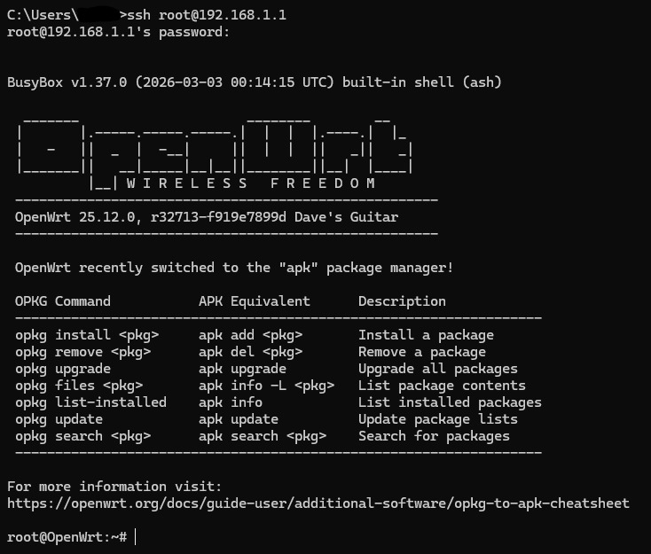

# Part 1: OpenWrt and Networking Foundations

## 1. Introduction

This project began with the repurposing of an old NETGEAR WNDR3700v4 router, with the primary goal being to use it as the default gateway for an isolated networking environment. This provides me with an opportunity to develop practical skills in IPv4 addressing, routing and network configuration. Additionally, a subnetting and VLAN addressing plans were developed to support future network expansion and segmentation.

## 2. Project Objectives

- Install OpenWrt firmware on the NETGEAR WNDR3700v4 router to allow for advanced configuration and management.
- Design and implement a custom IPv4 subnet for the networking environment.
- Configure a DHCP pool to automatically assign IPv4 address to connected devices.
- Enable SSH access to manage and investigate the router through a Linux command-line interface.
- Examine all network interfaces, routing tables and neighbor tables to develop an understanding of networking using Linux commands.
- Investigate default DNS services and firewall configurations.
- Establish a foundation for future VLAN implementation, network segmentation and network expansion.

## 3. Hardware and Software

### 3.1 Hardware

- NETGEAR WNDR3700v4 (Router) - The default gateway for the isolated lab network.

[IMAGE OF ROUTER HERE]

- Lenovo Yoga Slim (Laptop) - The end device used to configure, manage and test the network.
- Ethernet Cable - Provides wired connectivity between the laptop and router.
- USB-C Hub with Ethernet Adapter - Provides Ethernet connection as laptop lacks a built-in Ethernet port.

### 3.2 Software

- OpenWrt - A Linux-based router operating system.
- LuCI - The web-based GUI for configuring OpenWrt.
- SSH - Provides encrypted remote access to the router.
- Windows Command Prompt - Used for network discovery and troubleshooting.
- Web Browser - Used to access the router's default administrative interface.

## 4. Initial Network Discovery

### 4.1 Establishing A Physical Connection

Before initial network discovery was conducted, the router was connected to the laptop via an Ethernet cable. One end of the Ethernet cable was connected to a LAN port on the router, while the other was connected to a USB-C hub with an Ethernet adapter, which was connected to the laptop. Upon connecting, the router was isolated from the household network with no WAN connection.

The primary goal of identifying the routers existing network configuration was to establish a baseline of its IPv4 addressing, subnet mask, default gateway and DHCP settings before making any changes.

### 4.2 Identifying Existing IP Configuration

To identify the laptops network configuration, the Windows command prompt was opened and the command `ipconfig /all` was run to reveal the laptops IPv4 address, subnet mask, default gateway and DCHP information.

### 4.3 Accessing The Router's Management Interface

The router's default management interface was accessed through the web browser by using the default gateway IP address identified with `ipconfig /all`. While this allowed for the configuration of basic network settings, it offered limited flexibility for configuring more advanced settings. This prompted the decision to explore a more flexible firmware alternative (OpenWrt).

## 5. IPv4 Subnet Design

Before installing OpenWrt, a custom IPv4 subnet would be designed to replace the existing LAN addressing scheme while providing additional practical experience with subnetting. The `192.168.1.0/27` network was selected for the host lab environment. 

NOTE: This initial network of `192.168.1.0/27` was configured as a foundational exercise to practice simple IPv4 subnetting, LAN interface configuration and to understand how DHCP allocation works and how it is configured. This is a temporary network address before implementing the planned VLAN structure that is talked about in section 9.

### 5.1 Why /27?

The /27 prefix was selected as it provides 32 IPv4 addresses, of which there are 30 usable hosts addresses since `2^5 - 2` = 30. This was deemed sufficient for the small number of devices that would be connected to the isolated network environment.

### 5.2 IPv4 Addressing Scheme

The following addresses and DCHP allocation ranges were identified:

- **Network Address** = `192.168.1.0/27`
- **Subnet Mask** = `255.255.255.224`
- **Default Gateway** = `192.168.1.1`
- **Usable Host Range** = `192.168.1.1 - 192.168.1.30`
- **Broadcast Address** = `192.168.1.31`
- **DHCP Allocation Range** = `192.168.1.7 - 192.168.1.16`

## 6. OpenWrt Installation

To install the OpenWrt firmware on the router, the following steps were taken:

- Navigated to the OpenWrt firmware selector at [OpenWrt Firmware Selector](https://firmware-selector.openwrt.org/).
- Searched for the NETGEAR WNDR3700 v4 router to identify the compatible firmware.

**Figure 1: Searching for compatible firmware for the NETGEAR WNDR3700v4.**

- Downloaded the compatible Factory (.img) firmware image.
- Accessed the router's existing NETGEAR web management interface and navigated to the firmware upgrade section and uploaded the downloaded OpenWrt image.
- Allowed the firmware installation to complete and the router to reboot.
- Accessed the OpenWrt LuCI web interface to verify that the installation was successful.

## 7. Network and DCHP design

### 7.1 LAN Interface Configuration

To configure the LAN interface, I accessed the OpenWrt LuCI management interface and navigated to Network -> Interfaces -> LAN. The planned IPv4 addressing scheme was then applied to the interface by allocating the first usable host IP of `192.168.1.1/27` to the router.

**Figure 2: Assigned IP address to router interface.**

The first usable address was assigned to the router to ensure consistency and to allow for easy identification of default gateways for devices connected on the LAN. Furthermore, changing the subnet prefix from /24 to /27 reduces the available host address range from 254 to 30. The reason for this is explained below:

The below table shows the comparison between the /24 and the /27 subnet mask. Subnet masks are represented internally in binary (0's and 1's). 1 bits identify the network portion while 0 bits identify the host portion of an IPv4 address. 

| Subnet | First Octet | Second Octet | Third Octet | Fourth Octet | Subnet Mask |
|---|---|---|---|---|---|
| /24 | 11111111 | 11111111 | 11111111 | 00000000 | 255.255.255.0 |
| /27 | 11111111 | 11111111 | 11111111 | 11100000 | 255.255.255.224 |

Seen in the table above, the binary subnet mask always has the same number of 1's as the prefix. For example, it can be seen that the /24 prefix has 24 1's, likewise /27 has 27 1's in the binary subnet mask. It is also noted that the octet with all 1's set has the corresponding octet value in the subnet mask of 255. The relationship behind the binary subnet mask, its decimal representation and the number of available hosts is explained below: 

Each bit in an octet has a corresponding decimal value, doubling from right to left. This is seen in the table below:

| Bit Position | 1 | 2 | 3 | 4 | 5 | 6 | 7 | 8 |
|---|---|---|---|---|---|---|---|---|
| Decimal Value | 128 | 64 | 32 | 16 | 8 | 4 | 2 | 1 |
| /24 Mask | 0 | 0 | 0 | 0 | 0 | 0 | 0 | 0 |
| /27 Mask | 1 | 1 | 1 | 0 | 0 | 0 | 0 | 0 |

These values are used to calculate the subnet mask. The decimal values of all bits set to 1 are added together. For example, looking at the /27 subnet mask's final octet, the value is 224. This is due to `128 + 64 + 32 = 224`, as every bit that had a 1 was added with the decimal values.

Then, to find the number of available hosts, the remaining host bits are considered. Taking the /27 prefix for example, it can be seen that in the fourth and final octet there is a total of five 0's. It is known that a binary value can only have two states, which is 1 and 0. Therefore, to find the number of available hosts the following calculation is solved `2^5 - 2 = 30`. The number 5 represents the number of 0's, and subtracting 2 from the final value accounts for two addresses which are reserved for the network address and broadcast address.

### 7.2 DHCP Server Configuration

Dynamic Host Configuration Protocol (DHCP) dynamically assigns IP addresses to devices connected to a network, eliminating the need to manually configure an IP address on each device.

In the LuCI management interface, the DHCP server was configured by navigating to Network -> Interfaces -> LAN -> DHCP. As seen below in Figure 3, the DHCP address pool was modified with the first address in the DHCP allocation range until `192.168.1.7` through `192.168.1.16`.

**Figure 3: Modified DHCP server start and limit parameters to specify number of IP address available in the pool.**

The DHCP allocation range of `192.168.1.7 - 192.168.1.16` was selected to provide 10 dynamically assigned IPv4 addresses as this was deemed sufficient for the small number of devices expected to connect to the isolated network. The DHCP pool was configured to begin at `192.168.1.7`, leaving addresses `192.168.1.1 - 192.168.1.6` outside the allocation range for the router's gateway address and potential static assignments.

### 7.3 DHCP Configuration Verification

To verify whether the newly configured DHCP server was functioning as intended, the laptop was connected to the router using an Ethernet cable and the laptop's IP address was checked to see if it fell within the configured pool. The command to check the laptop IP was `ipconfig /all` in the Windows Command Prompt.

**Figure 4: An IP address from the DHCP pool was assigned to the laptop.**

As seen in Figure 4, the laptop obtained an IP address of `192.168.1.8` that falls between the allocation range of `192.168.1.7 - 192.168.1.16`. This confirms that DHCP is functioning correctly. Moreover, It can also be observed that there is a `/27` subnet mask and a default gateway address of `192.168.1.1`. 

## 8. Enabling SSH

To be able to interact with the router through a command line interface, a password was configured for the root account. This password was then used when connecting through ssh, by using the command `ssh root@192.168.1.1`.

**Figure 5: Initial SSH login into router via Windows Command Line Interface**

## 9. Next Steps

To expand on the networking lab, I plan to buy a cisco catalyst switch and configure the device using the cisco command line interface. Additionally, multiple VLANs will be created to aid me in VLAN configurations skills on a cisco switch, while also deepening my understanding into why network segmentation through VLANs is important from a security standpoint. To ensure proper preparation before implementing the VLANs, a VLAN plan was created below each having the relevant IP ranges which were calculated via VLSM to minimise wasted IP addresses and ensure each VLAN can support the planned amount of hosts.

## 9.1 Future VLAN Plan

## 10. Lessons Learned

Throughout, I learned how to flash new firmware onto a router, and enable SSH access onto the device. Moreover, I learnt that DHCP does not just randomly assign an IP address to a device, but instead picks from a pool of usable IP ranges to give a device. 

